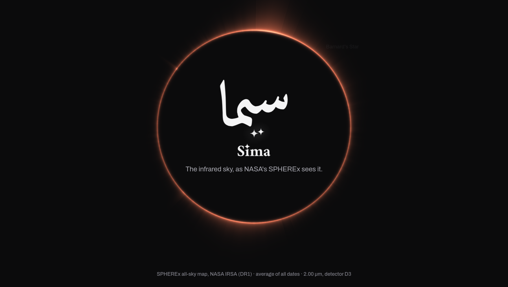
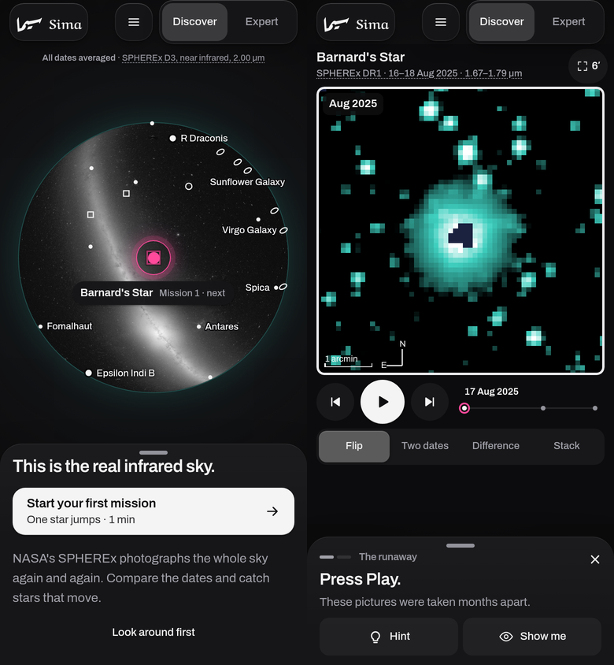
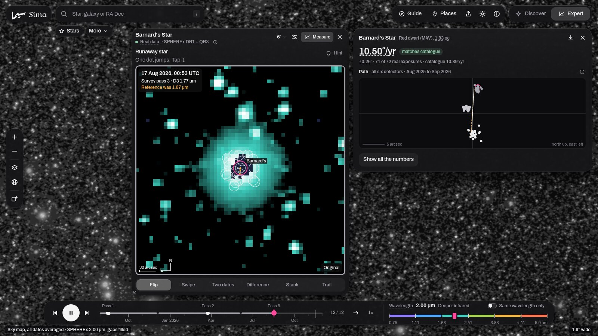

<p align="center">
  
</p>

# Sima (سيما)

**Watch NASA's SPHEREx infrared sky change over time.** Pick any spot on the sky, and Sima plays
SPHEREx's real pictures of it in date order, like a short video. Stars stay still. Anything that
moves or changes stands out.

**Try it: [sima-spherex.onrender.com](https://sima-spherex.onrender.com)** (works on phones and
desktops)

Built by team SIMA in Madinah for the NASA Space Apps Challenge 2026,
[Planet X and SPHEREx](https://www.spaceappschallenge.org/2026/challenges/planet-x-and-spherex/).
سيما means "a sign" or "a mark" in Arabic.

## The five test targets

The challenge names five objects. Each link opens straight on its pictures:

| Target | What you'll see |
|---|---|
| [Barnard's Star](https://sima-spherex.onrender.com/?target=barnard&intro=0) | The fastest-moving star in our sky. It visibly jumps between dates. |
| [Epsilon Indi B](https://sima-spherex.onrender.com/?target=eps-indi-b&intro=0) | A pair of brown dwarfs. They're brightest at long wavelengths. |
| [WISE 0855−0714](https://sima-spherex.onrender.com/?target=wise-0855&intro=0) | The coldest known brown dwarf. Too faint in any one picture; it appears when the pictures are stacked along its path. |
| [RW Aurigae](https://sima-spherex.onrender.com/?target=rw-aur&intro=0) | A young star whose brightness changes. |
| [R Draconis](https://sima-spherex.onrender.com/?target=r-dra&intro=0) | A pulsating giant star. Its brightness swings over months. |

## Two ways in

- **Discover** is for anyone. It opens on the whole sky as a globe, with three short missions:
  find the runaway star, make a hidden "ghost" appear by stacking, and look for a pretend Planet X.
  The Planet X mission is a simulation and says so on every screen.
- **Expert** is for people who want every number. It adds the measurement panel, all six
  detectors, the full timeline and wavelength bar, extra side-by-side frames, and downloads.

<p align="center">
  
</p>

<p align="center">
  
</p>

## What it does, against the challenge

| The challenge asks for | In Sima |
|---|---|
| Enter coordinates, see a series of images like a little video | Type a name or RA/Dec in the search box. The frame plays the pictures in date order. |
| Make moving objects easy to spot | Flip (play the dates), Swipe, Two dates side by side, and Difference (what changed). |
| Add together or subtract images taken at different times | Stack (add) and Difference (subtract). In Expert, Stack can follow a motion you drag, to pull out a faint mover. |
| Use the 102 bands and six detectors | Choose any wavelength from 0.75 to 5.0 µm, or one detector. Measure shows a spectrum made on the spot from the pictures. |
| Let users choose the field of view | 3′, 6′, 12′, 24′ or 48′ wide. Bigger fields catch faster movers but take longer to download. |
| Overlay other telescopes | Gaia DR3 stars and CatWISE2020 (WISE) sources, marked on the picture. |
| Show metadata such as contamination flags | Each picture's details name its date, survey pass, detector and wavelength, and the share of pixels NASA's pipeline flagged as bad. |
| Coordinates in the URL, for embedding | The address bar always holds what's on screen. Share gives a link and an embed code. |
| Easy to update with new data releases | Releases are read from NASA's archive by name (now DR1 and QR3). A new release is a one-line addition. |

Measure also gives numbers you can check: Barnard's Star's motion comes out at about 10.5″ per
year from the pixels, against 10.39″ per year in the Gaia catalogue.

## The data is real

Every picture is a real SPHEREx exposure from NASA/IPAC's archive (IRSA). Nothing is made up.

- **The five targets** ship with the app (about 8 MB, in `public/data/`), so they open instantly.
- **Any other spot** is fetched live from IRSA by a small service (`scripts/live.py`). A new spot
  takes a few minutes. The page says so and stays usable meanwhile.
- **The sky map** is SPHEREx's all-sky map, read straight from IRSA.
- **Star and galaxy names** come from SIMBAD, the IAU star names list, OpenNGC, Wikidata and
  Wikipedia.
- **Every picture names its source, release, date and wavelength.** When something can't be
  measured, the page says "Not measured" and why, instead of guessing.
- **The only simulation is Planet X.** It's labelled "Simulated" first, drawn dashed, and never
  mixed into real measurements, lists or downloads. A test checks this (`tests/sandbox.test.ts`).
- **Nothing in Sima claims a discovery.** Catalogue matches are called catalogue sources.

Sources and their terms are listed in the app's About page and in `docs/SPEC.md` section 6.1.

## Known limits

- **New spots depend on NASA's archive.** When IRSA is slow or down, a new coordinate can't get
  pictures. The page says NASA's search didn't answer. The five targets, the missions and the sky
  map still work, because they don't need that search.
- **The live service runs on Render's free plan.** It sleeps after 15 minutes without use, so the
  first new spot after a quiet spell waits about a minute longer. It has 512 MB of memory, so the
  widest fields (24′ and 48′) may fail to load.
- **Arabic interface.** Add `?lang=ar`, or switch in Settings. A few small labels, such as the
  scale mark on the picture, are still in English.

## Run it yourself

You need Node 22.18 or newer.

```bash
npm install
npm run dev        # http://localhost:5173
```

That's enough for the five targets, the missions and the sky map. To fetch any spot live, also set
up Python. `npm run dev` then starts the live service for you:

```bash
uv venv .venv
uv pip install -r scripts/requirements.txt
```

| Command | What it does |
|---|---|
| `npm run dev` | The site with live reload, plus the live service if `.venv` exists |
| `npm run build` | Builds the site into `dist/` |
| `npm run typecheck` | TypeScript checks |
| `npm test` | Unit tests |
| `npm run smoke` | Browser tests of every flow, in headless Chromium |
| `npm run test:py` | Tests of the Python data scripts and live service |

## Deploy

The live site uses two free Render services:

1. **The website** is a static site. Build command `npm ci && npm run build`, publish folder
   `dist`. Set `VITE_LIVE_API` to the live service's address plus `/api/patch`, and
   `NODE_VERSION=22`.
2. **The live service** is a Python web service. Build command
   `pip install -r scripts/requirements.txt`. Start command
   `python scripts/live.py --host 0.0.0.0 --port $PORT`. Set `SIMA_ALLOW_ORIGIN` to the website's
   address, and `SIMA_CACHE=/tmp/sima-cache`.

You can also run both from one container with the `Dockerfile`. `docs/deploy.md` has Google
Cloud Run and Azure steps.

## Link options

| Option | Meaning |
|---|---|
| `target` | A test target: `barnard`, `eps-indi-b`, `wise-0855`, `rw-aur`, `r-dra` |
| `ra`, `dec` | Any spot, in degrees |
| `fov` | Field size in arcminutes: 3, 6, 12, 24 or 48 |
| `det` | Detector `D1` to `D6`, or `color` |
| `view` | `flip`, `two`, `diff`, and in Expert `swipe`, `stack`, `trail` |
| `date` | The picture to start at, `YYYY-MM-DD` |
| `ui` | `discover` or `expert` |
| `lang` | `en` or `ar` |
| `embed=1` | Only the frame, for an iframe |
| `intro=0` | Skip the opening intro (it plays on every new visit) |

## How the code is organised

- `src/core/`: the science, as plain functions (motion fits, stacking, spectra)
- `src/sky/`: the sky map and globe
- `src/viewer/`: the frame, the timeline and the measurement panel
- `src/discover/` and `src/explore/`: Discover and its missions
- `src/shell/`: the cards on the sky, phone layout, settings and language
- `src/intro/`: the opening intro
- `scripts/`: the data scripts and the live service

`docs/SPEC.md` describes the behaviour and `DESIGN.md` the look.

## Credits and licences

- SPHEREx data: NASA/IPAC Infrared Science Archive (IRSA).
- Gaia DR3: ESA. CatWISE2020 and catalogue search: VizieR (CDS).
- Sky viewer: [Aladin Lite](https://aladin.cds.unistra.fr/AladinLite/) (CDS), GPL-3.0.
- Fonts: Archivo, Aref Ruqaa and Cairo, under the SIL Open Font License 1.1 (`src/styles/fonts/`).

The code and much of the text were written with AI coding assistants, directed and checked by the
team. The About page in the app says the same.
